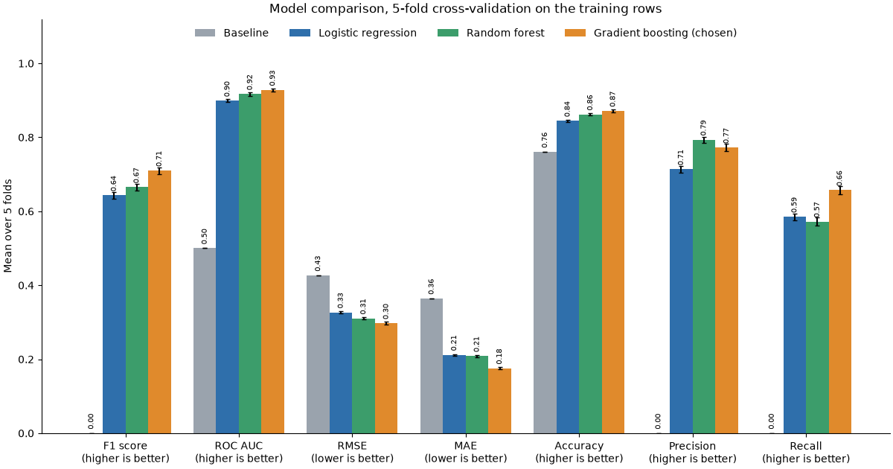

# Tabular Prediction with Exploratory Analysis

Predicts whether a person earns above 50,000 dollars a year from census data: exploratory analysis, cleaning, a scikit-learn feature pipeline, three models compared with cross-validation, and an error analysis.

## Demo



More images are in `docs/media/`: the chosen model on the test rows ([demo.png](docs/media/demo.png)) and a first look at the data ([data_overview.png](docs/media/data_overview.png)). All three are written by `python scripts/train.py`. The project has no hosted demo.

## Core focus

The complete workflow for a standard prediction problem, from raw files to a tested model, where one command reproduces every number.

## Skills demonstrated

- Python and Pandas for loading and cleaning
- Exploratory data analysis in a notebook
- Feature engineering with a scikit-learn `Pipeline` and `ColumnTransformer`
- Model comparison with stratified k-fold cross-validation
- Choosing, reading and questioning metrics
- Error analysis and a model card

## Quick start

You need Python 3.11 or newer.

```bash
python -m venv .venv && .venv/Scripts/activate
```

```bash
pip install -e ".[dev]"
```

```bash
python scripts/train.py
```

On macOS or Linux, activate the environment with `source .venv/bin/activate`.

The last command downloads the data (6 MB) on its first run, then cleans it, compares the models, tests the best one, and writes `reports/metrics.md`, `reports/metrics.json`, three figures and the model file. It took about 40 seconds on a 2-core laptop.

To open the notebook, install the extra tools with `pip install -e ".[notebook]"`. It is saved with its outputs, so it can also be read as it is.

### Run with Docker instead

If you have Docker, you do not need Python:

```bash
docker compose run --rm app
```

The reports and the model appear in the `reports/` and `models/` folders.

## How it works

```
scripts/train.py
   |
data.py       download and read the two raw files            -> data/raw/
cleaning.py   trim text, "?" -> missing, read the target,
              convert numbers, drop duplicates               -> data/processed/
features.py   ColumnTransformer: numbers (median, scale),
              capital gain/loss (log, scale),
              categories (missing label, group rare, one-hot)
models.py     baseline + logistic regression + random forest
              + gradient boosting, each as features -> model
training.py   80/20 split, 5-fold cross-validation on the 80%,
              choose the best, test it once on the 20%
errors.py     where the chosen model is wrong, by group
plots.py      the three figures
pipeline.py   runs all of it and writes reports/ and models/
config.py     every setting, including the seed
```

- The feature steps sit inside each model's pipeline, so medians, scales and category lists are learned from training rows only. Nothing leaks from the rows a model is checked on.
- The test rows are set aside first and used once, for the chosen model.
- The exploratory analysis is in [notebooks/eda.ipynb](notebooks/eda.ipynb). The design choices are in [docs/decisions.md](docs/decisions.md).

### Data

The [Adult dataset](https://archive.ics.uci.edu/dataset/2/adult) from the UCI Machine Learning Repository (Becker and Kohavi, 1996), taken from the 1994 United States census. License: Creative Commons Attribution 4.0 (CC BY 4.0). The data is not stored in this repository; `scripts/download_data.py` fetches it and checks each file's checksum.

After cleaning there are 48,790 people (52 exact duplicates removed), and 23.9% of them earn above 50K.

## Results

These numbers come from one short run on a laptop CPU, with default model settings and no tuning. The aim of this version is a complete, working pipeline; better scores are a later step.

### Cross-validation (5 folds on 39,032 training rows, mean)

| Model | F1 | ROC AUC | RMSE | MAE | Accuracy | Precision | Recall |
|---|---|---|---|---|---|---|---|
| Baseline (always the average) | 0.000 | 0.500 | 0.427 | 0.364 | 0.761 | 0.000 | 0.000 |
| Logistic regression | 0.643 | 0.899 | 0.327 | 0.212 | 0.844 | 0.714 | 0.585 |
| Random forest | 0.665 | 0.917 | 0.310 | 0.209 | 0.862 | 0.794 | 0.572 |
| **Gradient boosting (chosen)** | **0.710** | **0.928** | **0.297** | **0.175** | **0.872** | 0.772 | **0.657** |

Gradient boosting is best on every metric except precision. The spread between folds is small (a standard deviation of about 0.01 at most); it is in [reports/metrics.md](reports/metrics.md).

### Test rows (9,758 people the model never saw)

| Model | F1 | ROC AUC | RMSE | MAE | Accuracy | Precision | Recall |
|---|---|---|---|---|---|---|---|
| Gradient boosting | 0.724 | 0.933 | 0.292 | 0.171 | 0.876 | 0.776 | 0.678 |
| Baseline | 0.000 | 0.500 | 0.427 | 0.364 | 0.761 | 0.000 | 0.000 |

The test scores are close to the cross-validation scores, so the comparison did not overfit.

### What each metric says, and where it is weak

All four requested metrics are reported. F1 and ROC AUC are made for yes/no problems like this one. RMSE and MAE are regression metrics; here they measure how far the predicted probability is from the true answer (0 or 1).

| Metric | Result on the test rows | What it says here | Its weakness |
|---|---|---|---|
| **F1** | 0.724 (baseline 0.000) | A balance of precision (78% of the people flagged as high income really are) and recall (68% of the high incomes are found). | It depends on the cut-off (0.5 here) and ignores the correct "50K or less" answers. It also treats a miss and a false alarm as equally bad, which may not be true in a real use. |
| **ROC AUC** | 0.933 (baseline 0.500) | Take one person from each class at random: the model gives the high earner the higher probability 93% of the time. | It only measures ranking. It says nothing about whether the probabilities are right or which cut-off to use, and with unbalanced classes it can look better than the model feels in use. |
| **RMSE** | 0.292 (baseline 0.427) | The typical distance between the predicted probability and the truth, with large errors counted more. Its square is the Brier score. | The number is hard to explain to a non-specialist, and confident wrong answers dominate it. With 76% of people in one class, the baseline already scores 0.427, so it must always be read against the baseline. |
| **MAE** | 0.171 (baseline 0.364) | The average distance between the predicted probability and the truth. | It rewards pushing probabilities towards 0 or 1, so a model can improve MAE while its probabilities become less honest. It is the least informative of the four for this problem. |

Accuracy (0.876) is shown for completeness. Its weakness is plain here: always answering "50K or less" already gives 0.761.

**The model is chosen by F1** (set as `selection_metric` in `config.py`). The classes are unbalanced and the output is a yes/no answer, so F1 fits best. In this run the choice does not matter: gradient boosting also wins on ROC AUC, RMSE and MAE.

### The plots, briefly

- **Thumbnail (model comparison):** each group of bars is one metric, each colour one model. The grey baseline shows what "no skill" looks like. Every real model beats it clearly, and gradient boosting (orange) is ahead by a small but steady margin.
- **[demo.png](docs/media/demo.png) (test rows):** left, the ROC curve bends far from the diagonal, which is the 0.933. Middle, the four counts: 6,966 and 1,583 right, 456 false alarms, 753 high incomes missed. Right, the predicted probabilities: most low incomes get a probability near 0, but high incomes are spread out, which is why recall is the weak side.
- **[data_overview.png](docs/media/data_overview.png) (the data):** three people in four earn 50K or less. The share of high incomes rises steeply with education, and rises then falls with age.

### Where the model is wrong

The model misses a high income more often than it raises a false alarm. It misses 43% of high-earning women against 30% of men, and over 60% of high earners with a high-school education or less. Details and numbers are in [docs/error_analysis.md](docs/error_analysis.md). The intended use and the limits of the model are in the [model card](docs/model_card.md).

## Tests

```bash
ruff check .
```

```bash
pytest
```

```bash
python scripts/validate_portfolio.py
```

The 80 tests use a small made-up table and never download anything. They cover reading and cleaning, the features, each metric on a case worked out by hand, the training, and that the same seed gives exactly the same metrics.

## Limitations

- No tuning: the models use near-default settings, and the cut-off stays at 0.5.
- The probabilities were not calibrated or checked for calibration.
- The data is from 1994 and from one country. The model says nothing reliable about incomes today.
- The data includes sex, race and country of birth, and the model uses them. Its errors differ between groups (see the error analysis). It must not be used to make decisions about people.
- The model file is not stored in the repository. Run the training to create it.

## Next steps

- Tune the best model and choose the cut-off on validation data.
- Check and improve the calibration of the probabilities.
- Compare the model with and without the sensitive columns.
- Retrain with heavier settings on a stronger machine (the settings are all in `config.py`).

## License

MIT. See [LICENSE](LICENSE). The dataset has its own license (CC BY 4.0), described above.
